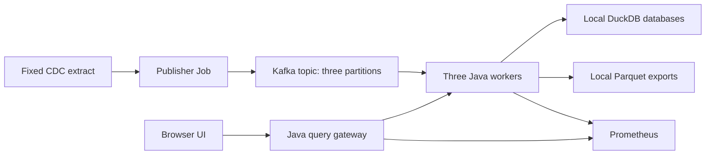

# Viro design

## Scope

Build a working local system with one query and useful measurements. Use Java 21, Kafka, DuckDB, Parquet, a static UI, Prometheus, and kind. Keep one application artifact with publisher, worker, and gateway roles.



## Data flow

The host fetch script downloads a bounded, deterministic selection of recent observations for each pathogen. It records the source URLs, eligibility policy, retrieval time, row count, and SHA-256 checksum.

A Kubernetes ConfigMap supplies the extract to the publisher Job. The publisher creates the topic if necessary and rejects an existing topic with any partition count other than three. It publishes with acknowledgements and idempotence enabled.

The natural key is site, pathogen, and reporting week. Partition routing uses Java String.hashCode over the three values separated by vertical bars, then floorMod with three. This specified routing remains stable across producer restarts.

Worker ordinal zero, one, or two owns the corresponding partition. Its persistent volume contains one DuckDB database and completed Parquet exports. Kafka auto-commit is disabled. Store each batch and its next offset in one database transaction, then resume from that offset after restart.

The fixed extract is immutable for the demonstration. Replaying it must not increase the number of distinct observations. This contract does not implement CDC historical revision processing.

## Query

The only query groups observations by state, pathogen, and activity level:

```sql
SELECT state, pathogen, activity, COUNT(*) AS observation_count
FROM observations
WHERE /* optional typed filter predicates */
GROUP BY state, pathogen, activity
ORDER BY state, pathogen, activity
```

Supported request filters are state, site, pathogen, week_from, week_to, and activity. Bind filter values as parameters. Clients cannot supply SQL identifiers, expressions, or file paths.

Each worker executes the query against its owned database or its registered Parquet export. The gateway adds counts for identical groups. Any unavailable worker makes the complete query fail visibly rather than return a successful partial count.

The UI offers these filters, a result table, database or Parquet mode, and a flush action. A complete unfiltered query after ingestion must count exactly the distinct source rows.

## Flush and recovery

Export the full local table to a temporary Parquet file, publish the completed file atomically on the same filesystem, and register its location for queries. Incomplete exports must remain invisible.

Keep the database rows after export. Database and Parquet are alternative query modes; never union both copies.

Flush after the ingestion backlog drains for the demonstration. Exports are independent per partition, and the system does not promise a global point-in-time snapshot during active writes. Report a flush failure and compare modes only after all worker exports succeed.

Use one owner process for database reads and writes, consistent with [embedded DuckDB concurrency](https://duckdb.org/docs/1.5/connect/concurrency). Serialize access where needed. Keep files on persistent volumes across pod restarts.

## Local deployment

Use one dedicated kind node, one Kafka broker with replication factor one, three worker pods, one gateway, a transient publisher Job, and Prometheus.

The inspected Mac has 32 GiB RAM and ten cores. Its active local Docker engine exposes two CPUs and about 8 GiB. The initial deployment uses that allocation and records it as a shared resource ceiling in any measurements.

Keep memory, producer buffering, batch size, and request concurrency bounded. JVM heap and DuckDB native memory share the container limit. Expose the UI and Prometheus through local port forwarding.

## Deliberate limits

The first release does not include arbitrary SQL, automatic CDC refresh, dynamic partition ownership, a Grafana deployment, multiple Kafka brokers, or a distributed hot/cold storage engine.

A pod restart is recoverable while its persistent volume and Kafka history survive. Cluster deletion, Docker reset, or host-disk failure can destroy local state.

A later source-refresh feature must import and validate complete source versions before replacing visible data. CDC's historical recalculation makes naive append-only refresh incorrect.
